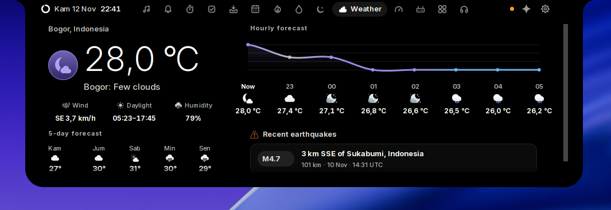
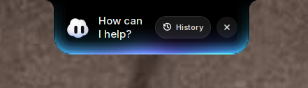
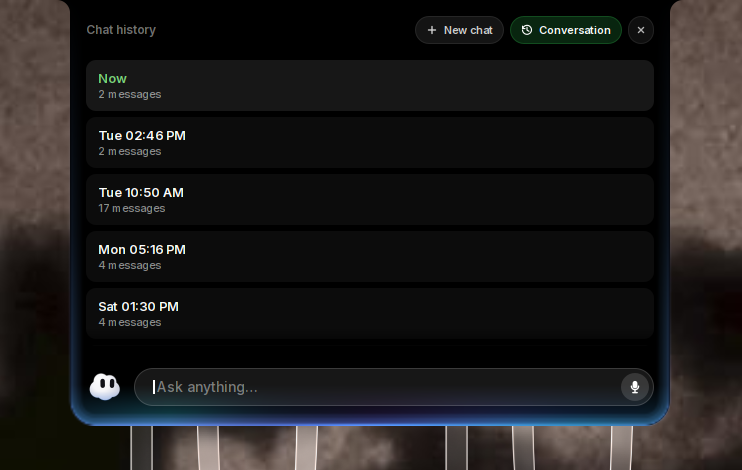
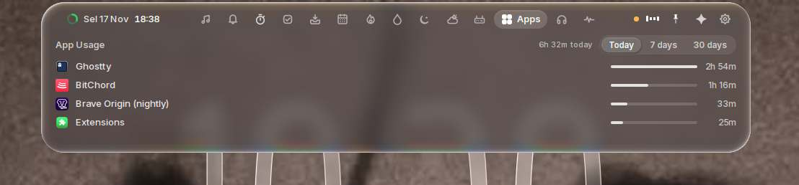
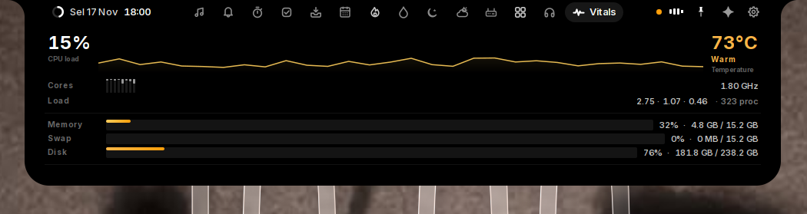
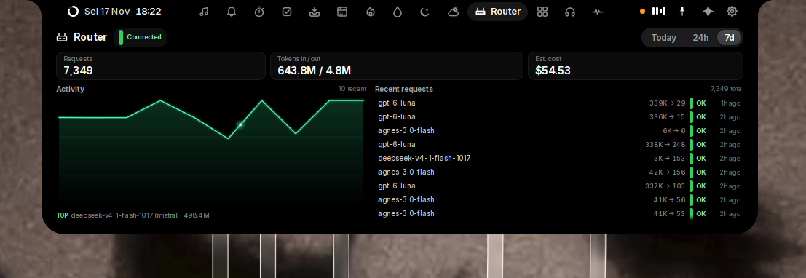
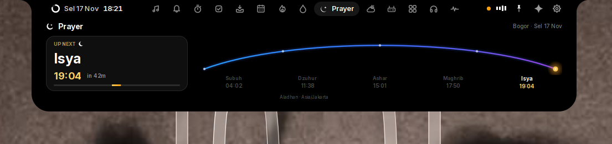
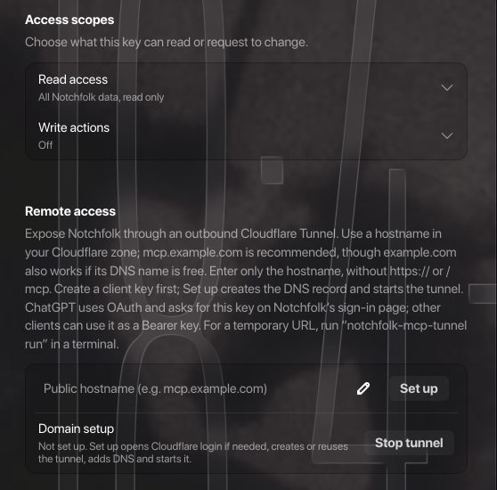
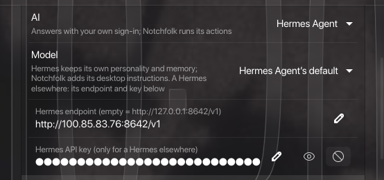

<div align="center">


Your desktop notch, alive — GNOME today, Windows and macOS next. Music with synced lyrics and karaoke, calls, a focus timer, calendar, food and water tracking, prayer times, weather, system vitals, a file shelf, app usage, phone integration, and AI agents (Hermes, Claude Code, Grok, Codex, OMP) through a built-in MCP server — with AI router analytics and subscription usage quota tracking.

[](LICENSE)


[](https://modelcontextprotocol.io)
[](https://github.com/ggerganov/whisper.cpp)
[](https://github.com/sponsors/galyarderlabs)

Notchfolk turns the centre of the top bar into a black notch. At rest, the
clock sits in the middle with what's running beside it — a song, a call, a
timer. Rest the pointer on it and it springs open into a small panel with
tabs for each page; pin it open to keep it there while you work elsewhere.

<table>
<tr>
<td width="50%" valign="top">
<br>
</td>
<td width="50%" valign="top">
<br>
</td>
</tr>
</table>

</div>

## Features

<table>
<tr>
<td valign="top">
<br>
<b>Music.</b><br>
Your music in the island — cover, scrubber and controls.<br>
<table>
<tr><th>Do this</th><th>To</th></tr>
<tr><td>Play from Spotify, YouTube in your browser, or any MPRIS player</td><td>Cover, scrubber and controls, with the playing app's icon on the cover</td></tr>
<tr><td>Middle-click the notch</td><td>Play or pause</td></tr>
<tr><td>Right-click the notch</td><td>Bring the music player to the front</td></tr>
<tr><td>Click the other player's icon</td><td>Switch players, with two music players running</td></tr>
</table>
</td>
</tr>
<tr>
<td valign="top">
<br>
<b>Synced lyrics.</b><br>
The line being sung, large and bright.<br>
<table>
<tr><th>Do this</th><th>To</th></tr>
<tr><td>Turn on lyrics online</td><td>Lyrics load from LRCLIB while songs play</td></tr>
<tr><td>Click a line</td><td>Jump to it</td></tr>
<tr><td>Play a song LRCLIB does not know</td><td>Shows "No lyrics found"</td></tr>
</table>
</td>
</tr>
<tr>
<td valign="top">
<br>
<b>Calls.</b><br>
Your calls in the island.<br>
<table>
<tr><th>Do this</th><th>To</th></tr>
<tr><td>Take a call in WhatsApp, Telegram, Zoom, Meet or a browser call page</td><td>A green phone in the closed island, the call's length on the Call page</td></tr>
<tr><td>Open the call</td><td>Watch it live while you work elsewhere, mute, or jump back to the call</td></tr>
<tr><td>Right-click the notch</td><td>Bring the call to the front</td></tr>
</table>
</td>
</tr>
<tr>
<td valign="top">
<br>
<b>Timer.</b><br>
A Pomodoro timer with breaks and Do Not Disturb while you focus.<br>
<table>
<tr><th>Do this</th><th>To</th></tr>
<tr><td>Type or step with − and +</td><td>Set the work and break lengths (locked from Start until Reset)</td></tr>
<tr><td>Press Start</td><td>The timer runs; Do Not Disturb stays on while you focus</td></tr>
<tr><td>Glance at the closed island</td><td>The time left stays there; beside a song or a call it shows as a small ring</td></tr>
</table>
</td>
</tr>
<tr>
<td valign="top">
<br>
<b>Reminders.</b><br>
Tasks that clear themselves at midnight.<br>
<table>
<tr><th>Do this</th><th>To</th></tr>
<tr><td>Add a task</td><td>It joins the list, with the number still open beside it</td></tr>
<tr><td>Rename in place</td><td>Change a task's title</td></tr>
<tr><td>Tick a task</td><td>Finish it — done ones clear at midnight</td></tr>
</table>
</td>
</tr>
<tr>
<td valign="top">
<br>
Clipboard history<br>
<br>
Files tray<br>
<br>
Shelf on your phone<br>
<br>
Devices<br>
<b>Shelf.</b><br>
Clipboard, files and your phone, in the island.<br>
<table>
<tr><th>Do this</th><th>To</th></tr>
<tr><td>Press Super+V</td><td>Open the clipboard history with search ready; Enter pastes</td></tr>
<tr><td>Search, filter, pin</td><td>Find text, links, images and files you copied</td></tr>
<tr><td>Drag a file towards the notch</td><td>Open the files tray to drop it — as many as you set in Settings; a long row scrolls</td></tr>
<tr><td>Drag a file out of the tray, or click it</td><td>Drop it into any app, or copy it</td></tr>
<tr><td>Scan the QR</td><td>Save shelf files on your phone or send files back, in the browser, same Wi-Fi, nothing through the internet</td></tr>
<tr><td>Ring phone, Send clipboard</td><td>Reach your GSConnect phone from the Devices image</td></tr>
</table>
</td>
</tr>
<tr>
<td valign="top">
<br>
<b>Weather.</b><br>
Your city's weather and the week ahead.<br>
<table>
<tr><th>Do this</th><th>To</th></tr>
<tr><td>Choose a city in Settings, or follow the GNOME World Clock</td><td>The forecast for that city, or the one nearest your time zone</td></tr>
<tr><td>Set the temperature's unit</td><td>Auto, Celsius or Fahrenheit</td></tr>
<tr><td>Open the page</td><td>Current conditions, humidity, wind, sunrise and sunset, an hourly curve colored by each forecast condition, and the five-day forecast</td></tr>
<tr><td>Look for earthquakes</td><td>Nearby ones from BMKG in Indonesia and USGS elsewhere; USGS fills in when BMKG has no nearby recent event</td></tr>
</table>
</td>
</tr>
<tr>
<td valign="top">
<br>
<b>Calendar.</b><br>
The month beside the chosen day's events.<br>
<table>
<tr><th>Do this</th><th>To</th></tr>
<tr><td>Connect your desktop calendars</td><td>Google and others through Online Accounts</td></tr>
<tr><td>Type "Dinner 8:00 pm"</td><td>Add an event in one line</td></tr>
<tr><td>Wait 5 minutes before</td><td>A reminder, with Join for Meet, Zoom, Teams or Webex</td></tr>
<tr><td>Look underneath</td><td>World clocks</td></tr>
</table>
</td>
</tr>
<tr>
<td valign="top">
<br>
<b>Notifications.</b><br>
GNOME's notifications as a plain list.<br>
<table>
<tr><th>Do this</th><th>To</th></tr>
<tr><td>Open the list</td><td>Newest first, with their buttons under the pointer</td></tr>
<tr><td>Press Clear</td><td>Clear the list</td></tr>
<tr><td>Rest the pointer on an alert</td><td>Keep it until the pointer leaves</td></tr>
<tr><td>Swipe up or down on an alert (touchpad)</td><td>Put it away, or open it</td></tr>
<tr><td>Right-click the notch</td><td>Put an alert away</td></tr>
</table>
</td>
</tr>
<tr>
<td valign="top">
<br>
<b>Voice assistant.</b><br>
Press Super+I and ask, in English or Indonesian.<br>
<table>
<tr><th>Do this</th><th>To</th></tr>
<tr><td>Press Super+I, then speak</td><td>Ask: play a song, find a file, add a reminder</td></tr>
<tr><td>Press Super+I again</td><td>Finish speaking, or after an answer, ask more</td></tr>
<tr><td>Start typing (or click the keyboard)</td><td>Type the request instead</td></tr>
<tr><td>Ask for something with several steps</td><td>It is done one step after another, each step checked</td></tr>
<tr><td>Pick the AI in Settings</td><td>Claude Code, Codex, Grok, Hermes, Oh My Pi, opencode or Antigravity answers</td></tr>
</table>
</td>
</tr>
<tr>
<td valign="top">
<br>
<b>Installs and fixes things.</b><br>
Ask it to install or fix something on your Linux.<br>
<table>
<tr><th>Do this</th><th>To</th></tr>
<tr><td>Say "Install LibreOffice" or "pasang codex"</td><td>It checks what your Linux has, searches the web when unsure, and shows the one command it wants to run, with what to know first</td></tr>
<tr><td>Press Run</td><td>It runs in the background while you carry on</td></tr>
<tr><td>Press Deny</td><td>It does not run</td></tr>
<tr><td>Wait for the answer</td><td>The assistant checks it worked before saying so</td></tr>
</table>
</td>
</tr>
<tr>
<td valign="top">
<br>
Conversation<br>
<br>
Chat history<br>
<b>Speak or type, and talk it through.</b><br>
The conversation is the chat itself.<br>
<table>
<tr><th>Do this</th><th>To</th></tr>
<tr><td>Type in Ask anything at the bottom</td><td>Keep talking</td></tr>
<tr><td>Pick a past conversation</td><td>Reopen it, with its message count beside it</td></tr>
<tr><td>Press + New chat</td><td>Start a new one</td></tr>
</table>
</td>
</tr>
<tr>
<td valign="top">
<br>
<b>A bot of your own.</b><br>
Eight shapes, eleven colours, one glow to match.<br>
<table>
<tr><th>Do this</th><th>To</th></tr>
<tr><td>Pick a shape in Settings</td><td>From a circle to a cloud or a ghost</td></tr>
<tr><td>Pick a colour, or your own</td><td>The glow round the island matches it</td></tr>
<tr><td>Open the live preview</td><td>See the bot before you pick it</td></tr>
</table>
</td>
</tr>
<tr>
<td valign="top">
<br>
<b>AI usage.</b><br>
How much of your Claude and ChatGPT plan limits is used.<br>
<table>
<tr><th>Do this</th><th>To</th></tr>
<tr><td>Open the page</td><td>One plan at a time with its logo, a bar per limit and when each resets</td></tr>
<tr><td>Scroll or click the dots</td><td>Switch plans</td></tr>
<tr><td>Choose plans in Settings</td><td>Only those plans show; only plans you're signed in to show at all</td></tr>
<tr><td>Watch for the warning</td><td>One comes as a limit nears its end</td></tr>
</table>
</td>
</tr>
<tr>
<td valign="top">
<br>
<b>Alerts.</b><br>
Everything that needs you, in one place instead of the middle of the screen.<br>
<table>
<tr><th>Do this</th><th>To</th></tr>
<tr><td>Wait for an alert</td><td>Volume, brightness, Caps Lock, charging, low battery, Bluetooth battery, going offline, reminders, meetings about to start, AI plan limits and GNOME notifications with their buttons</td></tr>
<tr><td>Hold the pointer on one</td><td>Keep it</td></tr>
<tr><td>Press × or swipe up</td><td>Put it away</td></tr>
<tr><td>Switch each alert on or off in Settings</td><td>Only those alerts show</td></tr>
</table>
</td>
</tr>
<tr>
<td valign="top">
<br>
<b>AI agents.</b><br>
Answer agent permission requests from the island.<br>
<table>
<tr><th>Do this</th><th>To</th></tr>
<tr><td>Press Deny</td><td>It does not run</td></tr>
<tr><td>Press Allow</td><td>It runs once</td></tr>
<tr><td>Press Always (Claude Code)</td><td>Always allow it</td></tr>
<tr><td>Wait for the island</td><td>When one is done, it says what it did</td></tr>
<tr><td>Switch an agent off in Settings</td><td>Its approvals stop showing</td></tr>
</table>
</td>
</tr>
<tr>
<td valign="top">
<br>
<b>App usage.</b><br>
Where your time goes.<br>
<table>
<tr><th>Do this</th><th>To</th></tr>
<tr><td>Turn it on</td><td>Tracking starts — off until you turn it on</td></tr>
<tr><td>Pick today, the last seven days, or the last 30</td><td>The app in front then, with its icon, a bar and its time</td></tr>
<tr><td>Leave the computer idle for five minutes</td><td>Tracking pauses; locking the screen stops it</td></tr>
<tr><td>Look back later</td><td>Kept on this computer for 30 days</td></tr>
</table>
</td>
</tr>
<tr>
<td valign="top">
<br>
<b>Glass.</b><br>
The island in clear dark glass instead of black, if you prefer.<br>
<table>
<tr><th>Do this</th><th>To</th></tr>
<tr><td>Choose Glass in Settings → Appearance → Island</td><td>What is behind it shows through, blurred, as you work</td></tr>
<tr><td>Move the slider</td><td>From clear to dark smoked glass</td></tr>
</table>
</td>
</tr>
<tr>
<td valign="top">
<br>
<b>Vitals.</b><br>
The machine's own pulse in the island.<br>
<table>
<tr><th>Do this</th><th>To</th></tr>
<tr><td>Open the page</td><td>CPU load and temperature big with the last minute drawn as a sparkline between them, each core a bar, the load averages and the process count, memory / swap / disk bars with their bytes, the network's rates, the battery and the uptime</td></tr>
<tr><td>Wait 2 s</td><td>Fresh numbers, sampled from /proc, no extension needed</td></tr>
<tr><td>Pick a vital in Settings</td><td>It rides the closed island beside the wave</td></tr>
<tr><td>Set the temperature's unit</td><td>Auto, Celsius or Fahrenheit</td></tr>
</table>
</td>
</tr>
<tr>
<td valign="top">
<br>
<b>Karaoke.</b><br>
The line being sung, in the closed island.<br>
<table>
<tr><th>Do this</th><th>To</th></tr>
<tr><td>Play a song with synced lyrics</td><td>The closed island's centre becomes the line being sung — the cover left, the wave right, the clock waiting</td></tr>
<tr><td>Sing along</td><td>The line holds one width for the whole song, so the island never pumps; a short line centres in the room its last long line held</td></tr>
</table>
</td>
</tr>
<tr>
<td valign="top">
<br>
Router<br>
<br>
Router settings<br>
<b>Router.</b><br>
What your AI gateway reports.<br>
<table>
<tr><th>Do this</th><th>To</th></tr>
<tr><td>Connect</td><td>Requests, tokens in and out, its cost estimate, the top models as bars, and the last ten requests — a health dot once connected</td></tr>
<tr><td>Set the period</td><td>Last 7 days, or your choice</td></tr>
<tr><td>Turn on Show on the notch</td><td>Router stats ride the closed island</td></tr>
</table>
</td>
</tr>
<tr>
<td valign="top">
<br>
Calories<br>
<br>
Water<br>
<br>
Prayer<br>
<b>Everyday tools.</b><br>
Water, calories and prayer times.<br>
<table>
<tr><th>Do this</th><th>To</th></tr>
<tr><td>Log water and calories through the day</td><td>Today's totals, kept on this computer</td></tr>
<tr><td>Open the Prayer page</td><td>The day's prayer times on a sun arc, with the next one and how long until it</td></tr>
</table>
</td>
</tr>
<tr>
<td valign="top">
<br>
MCP settings<br>
<br>
MCP access<br>
<br>
The world<br>
<b>MCP server.</b><br>
An optional MCP server for agents outside Notchfolk.<br>
<table>
<tr><th>Do this</th><th>To</th></tr>
<tr><td>List writes in <code>~/.config/notchfolk/mcp.env</code></td><td>Those writes are allowed; read tools work for your data and actions</td></tr>
<tr><td>Give a key no scope</td><td>Its restricted tools are not even visible to it</td></tr>
<tr><td>Open remote access</td><td>Reach it through an authenticated tunnel; on loopback by default</td></tr>
<tr><td>Look at the world domains</td><td>Seven, 150 tools in all: System (the machine itself — stats, logs, files, processes, updates, the sharp tools behind their own scope), Browser (the web through a real browser: Camoufox, or your own Chromium over CDP), Memory (the Hindsight engine's 39 tools — what the agent learns, kept across conversations), Notes (your own vault of Markdown notes, and memory's fallback), Skills (the world knows how to do things: the skill trees on the machine), Office (the world makes documents) and Composio (the world reaches your accounts — mail and drive, read on the default key, writes behind their own scope)</td></tr>
<tr><td>Run without a backend</td><td>A domain whose backend is absent is not offered at all</td></tr>
</table>
</td>
</tr>
<tr>
<td valign="top">
<br>
The AI picker<br>
<br>
OpenAI-compatible API<br>
<br>
Hermes Agent<br>
<b>More AIs.</b><br>
More AIs for the assistant.<br>
<table>
<tr><th>Do this</th><th>To</th></tr>
<tr><td>Pick a provider in Settings</td><td>The assistant runs Hermes and Oh My Pi with the providers they are configured for</td></tr>
<tr><td>Choose OpenAI-compatible API</td><td>Any OpenAI-compatible API answers</td></tr>
</table>
</td>
</tr>
</table>

Also: privacy dots while the camera, microphone or screen sharing is in use,
a recording timer with a stop button, and a slim glass top bar that leaves
your windows uncovered.

## Requirements

- **GNOME Shell 46 to 51** (Ubuntu 24.04 to 26.10, Fedora 40 to 45,
  Debian 13, …), on a 64-bit Intel or AMD PC (x86_64). Check with
  `gnome-shell --version`.
- `curl`, which most systems have (if not: `sudo apt install curl`). Install
  Notchfolk as yourself, not with `sudo`.
- For the voice assistant (optional): a microphone and
  one of Claude Code, Codex, Grok, opencode or Antigravity signed in (Codex and the npm
  install of Claude Code need Node.js 18 or newer); see
  [assistant guide](docs/assistant.md). To have the answers spoken aloud, `ffmpeg`
  (`sudo pacman -S ffmpeg`, `sudo apt install ffmpeg`), which turns the router's audio
  into what `pw-play` plays.

## Installation

1. Run this in a terminal:

   ```sh
   curl -fsSL https://raw.githubusercontent.com/galyarderlabs/notchfolk/main/get.sh | bash
   ```

2. **Log out and back in**: GNOME Shell on Wayland only loads a new
   extension at login (on GNOME 46 to 48 with X11, press Alt+F2, type `r`
   and press Enter instead).

That's all. The script downloads the latest release, checks it, and installs
it for your user only: no root, no compiler and no cloning needed. Run the
same command again to update; your settings stay as you set them.

The [installation guide](docs/install.md) goes through it step by step, with
updating, uninstalling, installing offline and what to do if the island does
not appear.

> [!NOTE]
> The installer never changes other extensions. When one would fight with
> the island (Blur my Shell's top bar blur, or an extension that takes the
> same place in the top bar), it says so and how to turn that off. Notchfolk's
> look is the same on every desktop: a slim top bar with no colour of its
> own, and the island as a black notch.

## Documentation

- [Usage and settings](docs/usage.md) — every gesture and shortcut, the
  Settings pages, troubleshooting and uninstalling
- [Assistant guide](docs/assistant.md) — the voice assistant, the AIs it
  runs (Claude Code, Codex, Grok, Hermes, Oh My Pi, opencode, Antigravity),
  agent approvals and AI plan usage
- [Installation guide](docs/install.md) — step by step, packages, AUR,
  offline install and other ways to install
- [MCP server](docs/mcp.md) — the optional MCP server and its permissions
- [Data and network](docs/data-and-network.md) — what is kept where and what
  leaves your computer; also [SECURITY.md](SECURITY.md)
- [How it works](docs/how-it-works.md) — the moving parts, D-Bus interfaces
  ([dbus-api.md](docs/dbus-api.md)) and resource usage

## Contributing

Bug reports, ideas and pull requests are welcome. See
[CONTRIBUTING.md](CONTRIBUTING.md) for how to build, test and send changes,
and [CHANGELOG.md](CHANGELOG.md) for what changed. Everyone taking part
follows the [Code of Conduct](CODE_OF_CONDUCT.md); please report security
problems privately as described in [SECURITY.md](SECURITY.md).

## Support

Notchfolk is free and always will be. If it makes your desktop nicer, you can
[sponsor Galyarder Labs on GitHub](https://github.com/sponsors/galyarderlabs).
A star, a bug report or telling a friend helps just as much.

## License

Notchfolk is a modified version of [Isle](https://github.com/zickrian/isle) by
zickrian, used under GPL-3.0-or-later. Copyright © 2026 zickrian for the
upstream work; Copyright © 2026 Galyarder Labs for the modifications — both
published under the same licence.

Notchfolk is free software: you can redistribute it and/or modify it under the
terms of the [GNU General Public License](LICENSE) as published by the Free
Software Foundation, either version 3 of the License, or (at your option) any
later version. It is distributed in the hope that it will be useful, but
WITHOUT ANY WARRANTY; without even the implied warranty of MERCHANTABILITY or
FITNESS FOR A PARTICULAR PURPOSE. See the [GNU General Public License](LICENSE)
for more details.

The bundled [Inter](https://rsms.me/inter/) typeface (`data/fonts`) is under
the [SIL Open Font License 1.1](data/fonts/Inter-LICENSE.txt). Lyrics come
from [LRCLIB](https://lrclib.net). The Claude and OpenAI logos on the AI usage page
come from [Simple Icons](https://simpleicons.org) (CC0); they are trademarks of
Anthropic and OpenAI, shown only to name their plans. The assistant's face
takes its expressions from [bloub](https://github.com/jeremy-prt/bloub) by
Jérémy Perret, under the MIT License
([notice](gnome-extension/NOTICE-bloub.txt)). The calendar icon takes its shape
from [Lucide](https://lucide.dev)'s "calendar-days", under the ISC License
([notice](gnome-extension/NOTICE-lucide.txt)).

---

<div align="center">

[](https://github.com/galyarderlabs/notchfolk)

</div>


